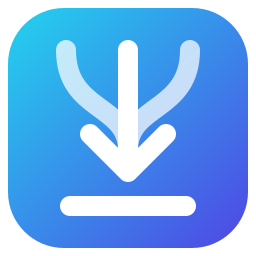
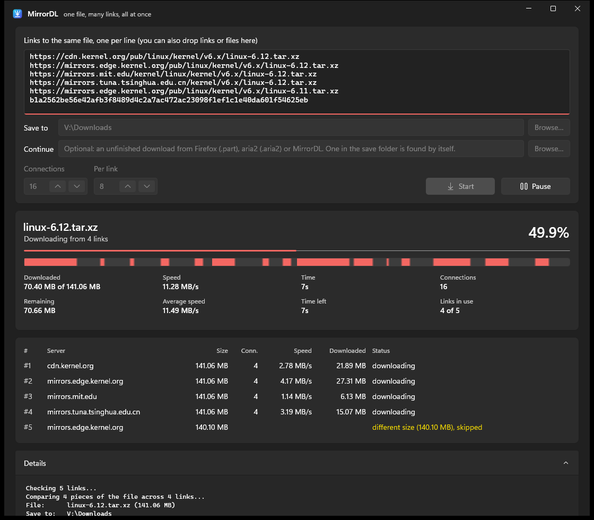
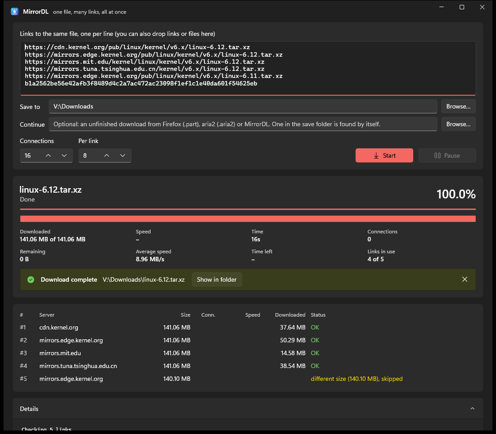

<p align="center"></p>

<h1 align="center">MirrorDL</h1>

<p align="center">Download files from several mirrors at once, after checking that they all serve the same file.</p>

<p align="center">
  <a href="https://github.com/Nawid3333/MirrorDL/actions/workflows/ci.yml"></a>
  <a href="https://github.com/Nawid3333/MirrorDL/actions/workflows/github-code-scanning/codeql"></a>
  <a href="https://github.com/Nawid3333/MirrorDL/releases/latest"></a>
  <a href="LICENSE"></a>
</p>

Paste the links to one file or to many: MirrorDL sorts them into files, shows you what it found, and
downloads each file from all of its mirrors at once. It can also continue unfinished downloads that
Firefox or aria2 left behind. It runs on Windows 10 and 11, as a window app and as a terminal program.



## Features

- **Many files, sorted by themselves.** Paste links to several files, also several mirrors of
  each: links with the same name, or the same size and content, are mirrors of one file; the
  others are files of their own. Before anything is downloaded, you see the files - name, size,
  links, what is wrong with a link - and tick what you want.
- **A download list.** Start new downloads while others run; pause, resume or take off each one,
  or all at once. The list is kept: after closing MirrorDL or restarting the PC, press Resume.
- **Links from web pages.** A link to a file host's page is searched for the link behind its
  download button. A page that needs a captcha opens in MirrorDL's own browser: solve it, click
  the download button, and MirrorDL takes the link. **Click'n'Load** takes the links from sites
  like filecrypt, as JDownloader does.
- **History and settings.** Finished downloads are listed, searchable, with their links. Every
  extra - the history, keeping the list, Click'n'Load, watching the clipboard, keeping the PC
  awake, the taskbar progress - is a switch in Settings, with what it does. The theme follows
  Windows, or is light, dark or **OLED black** (a pure black window).
- **One window.** Starting MirrorDL again, or dropping files on MirrorDL.exe, hands them to the
  window that is open.
- **All links at once.** Each link gets several connections. Faster links keep taking over work
  from slower ones until the end.
- **Finds the best number of connections by itself.** It adds connections to a link as long as
  they make the whole download faster, and stops where the server or your internet line is the
  limit, at most 16 per link. Nothing to set.
- **Checks the links first.** Links with a different size are skipped. MirrorDL also compares
  64 KB pieces from several places in the file across all links and skips links whose content
  differs, so you never get a file stitched together from two different versions.
- **Continues unfinished downloads**, also ones from other programs:
  - Firefox `.part` files, including Firefox's random names (`setup.Ab3-xY_z.exe.part`)
  - aria2 downloads: reads the `.aria2` control file to find the missing pieces
  - its own downloads, even after a crash or a power cut
  - **several unfinished files of the same download at once**, also under other names: it
    puts together what they hold and downloads only the rest

  Before continuing, it compares what is already on disk with the links. A file that doesn't
  match is never changed. Continuing reads only the progress file and a few pieces, not the
  whole file, so even a 50 GB download goes on right away.
- **Verifies the result** against a checksum (MD5, SHA-1, SHA-256, SHA-384 or SHA-512) if you
  paste one with the links - also several, for several files: with the file's name next to it
  (as in a `SHA256SUMS` file), or without, and MirrorDL finds which file it belongs to.
- **Shows the details:** percent, downloaded and remaining size, current and average speed, time
  spent and left, connections, a line per link, and a map of which parts of the file are done.
- **Copes with real servers:** retries dropped connections, uses fewer connections on servers that
  allow only a few, and saves the progress every 10 seconds and when you pause or close the window.

## Download

**The window app from the Microsoft Store**, which installs it and keeps it up to date:

[](https://apps.microsoft.com/detail/9P94PN403J5W?mode=direct)

or in a terminal: `winget install 9P94PN403J5W`

**Or from the [latest release](https://github.com/Nawid3333/MirrorDL/releases/latest):**
`MirrorDL-win-x64.zip` is the window app, `mirrordl-terminal-win-x64.zip` the terminal program.
Unzip and start; nothing gets installed.

They need Windows 10 (1809 or newer) or Windows 11, 64-bit, and the
[.NET 10 Runtime](https://dotnet.microsoft.com/download/dotnet/10.0). The window app brings the
Windows App SDK along.

**Updates:** the Store version gets them from the Store. The window app from the zip tells you
when a newer release is out, with a link to it. It asks GitHub once at start and sends nothing
else ([privacy policy](PRIVACY.md)).

## Use

### Window app

Start `MirrorDL.exe`, paste the links, and press **Check links**. MirrorDL shows the files they lead
to; tick the ones you want and press **Download**.



- Every link, checksum and unfinished file has a box of its own. Paste a whole list into any box,
  or drop it on the window: each line goes into a box of its own, in the list it belongs to, and
  next to each box MirrorDL says what it made of it.
- Links kept in a file: drop a `.txt` or `.md` file on the window, or press **From a file…** next
  to Links (that one reads any text file). MirrorDL takes the links and checksums written in it -
  also markdown's `[name](link)`, lists and tables - and leaves the words around them.
- The files of one check download one after another, each with all of the internet line, so the
  first ones are done soonest. Check more links while they run: those start next to them.
- Each download has its buttons: pause, resume, show in folder, take off the list. Click one to
  see its details below the list: speed, time left, connections, its links, a map of the file,
  and its messages. **Pause** saves the progress; so does closing the window during a download.
- A file that is in the save folder already, complete, is only checked, not downloaded again.
- **History** lists the finished downloads; **Settings** (the gear) has a switch for every extra.

`MirrorDL.exe --start <links…>` fills in the links and starts at once, without showing the files
first.

### Links from web pages and link sites

Some links lead to a page with a download button rather than to the file. MirrorDL reads the page
and takes the links to files on it. A page whose link only appears after a captcha or a click
shows none: **Open page** opens it in MirrorDL's browser. Solve the captcha, click the download
button, and MirrorDL takes the link and shows the file - the page's own download doesn't happen.
MirrorDL never solves a captcha for you.

Link sites such as filecrypt have a **Click'n'Load** button. Solve their captcha in your browser
and press it: the links go to MirrorDL (on 127.0.0.1, port 9666, which only your PC can reach), and
MirrorDL shows the files - nothing is downloaded before you say so. Only one program can take the
links at a time: close JDownloader to use it in MirrorDL.

### Terminal

```
mirrordl                                      asks you to paste the links
mirrordl "https://a/file.iso" "https://b/file.iso" -o D:\Downloads
mirrordl links.txt                            links to one file or many, and checksums (or links.md)
mirrordl "C:\Users\me\Downloads\file.Ab12-xYz.iso.part" "https://a/file.iso"
```

With links to several files, it lists the files it found, downloads them one after another, and
sums up how each went.

| Option | Meaning |
|---|---|
| `-o <folder>` | where to save (default: Downloads, or next to the unfinished file) |
| `-c <n>` | at most n connections in total, 1 to 64 (default: no limit) |
| `-m <n>` | at most n connections per link, 1 to 64 (default: 16) |
| `--delete-leftovers` | delete leftovers that can't go to the Recycle Bin for good, without asking |
| `--one-file` | all links are mirrors of one file: don't sort them into files |
| `--no-pages` | don't look for links to files on pasted web pages |

Ctrl+C pauses. Run the same command again to continue.

## How links are sorted into files

1. MirrorDL asks every link for its file's name and size, at most two at a time per server.
2. Links with the same file name - from the server, or a file name in the address - are mirrors of
   one file. Of those, a link with another size or content serves an old or wrong file: it is
   skipped, as before.
3. Links with other names but the same size are compared by a few 64 KB pieces of content: the
   same content means the same file under another name (a mirror that renamed it); other content
   means another file, as with the parts of a split archive, which all have one size.
4. A link that doesn't work goes with the file its address names, or shows as a file of its own
   that can't be downloaded. Two different files of the same name get numbered names
   (`download`, `download (1)`), also across downloads that run at the same time.

Checksums go with the file named on their line (`<checksum>  name`, or `SHA256 (name) = <checksum>`)
or the link on their line; with one file, all are that file's. A checksum that says nothing of its
file is compared with each file at the end: the file that matches it is checked; one that matches
none of them is said, but not called damaged - the checksum may be another file's. Unfinished
files you add go with the file of their name, or of the size their progress file tells.

## Continuing downloads from Firefox and aria2

MirrorDL looks in the save folder for an unfinished download of the same file. You can also
choose one yourself.

- **Firefox** saves `name.Ab12-xYz.ext.part` and an empty `name.ext` next to it. MirrorDL continues
  the `.part` file and puts the finished file in place of the empty one. Pause the download in
  Firefox or close Firefox first. **Don't cancel it in Firefox: that deletes the `.part` file.**
- **aria2** writes pieces all over the file, so the file size says nothing about how much is done.
  MirrorDL reads the `.aria2` file to find the missing pieces. Stop aria2 first.

A file you choose keeps its name and folder, also when the links give another name. Only a `.part`
file gets its final name once it is done.

If the file you choose is complete already, MirrorDL only checks it: against the links, and
against the checksum if you paste one. It doesn't write to it, rename it or move it. That makes
it a quick way to check a finished download. If the links can't send parts of the file and you
paste no checksum, only its size can be checked, and MirrorDL says so.

### Several unfinished files of the same download

Browsers download a file from the start to the end, so of two Firefox `.part` files of the same
download the bigger one already holds everything the smaller one has. aria2 and MirrorDL download
pieces all over the file, so their unfinished files can hold different parts. MirrorDL uses them all:

1. It finds the unfinished files of the download in the save folder, also numbered copies like
   `name(1).ext.part`. Files under other names you add yourself (several at once: one per line
   in **Continue**, or drop them on the window).
2. It compares each one with the links. A different file is left as it is.
3. The one holding the most is continued; what the others hold beyond it is copied into it.
   Copying on the disk is much faster than downloading.
4. Only the rest is downloaded. Once the finished file checks out, the other unfinished files go
   to the Recycle Bin, with their progress files.

What "checks out" means: the download finished with the right size, and the file matches the
checksum you pasted, or, without one, the links at every piece compared before. A file is
only removed if it was found to be this download, hasn't changed since, and no other program has
it open. If anything fails, a download stops, is paused or comes out damaged, nothing is removed.

Only unfinished downloads are removed: `.part` files, and files with a `.aria2` or `.mirrordl`
progress file. Any other file you added stays, since it may be one of your own.

MirrorDL moves them to the Recycle Bin. A file that can't go there - too big for it (the
Recycle Bin of a drive holds a few percent of it at first), or its drive has none - can only be
deleted for good, so MirrorDL asks once the download is done, and keeps it if you say no. Tick
**Delete leftovers that can't go to the Recycle Bin, without asking** (in the terminal:
`--delete-leftovers`) to have them deleted without the question. Either way, a leftover is
checked again right before: one that changed or that another program has open stays. (Should Windows delete a file for good while moving it to the Recycle
Bin, MirrorDL says so.) To have big leftovers go to the Recycle Bin instead, make it bigger:
right-click it, **Properties**, **Custom size**.

A file from aria2 or MirrorDL needs its progress file (`.aria2` or `.mirrordl`) next to it, since
only that tells which parts are downloaded. Without it, MirrorDL doesn't use the file.

## Limitations

- Direct download links only (HTTP and HTTPS). Pages that need a login, cookies or a captcha
  before the download starts won't work.
- The servers must support range requests to use more than one connection and to resume. For
  servers that don't, MirrorDL falls back to one connection.

## Build

Needs the .NET 10 SDK. Open `MirrorDL.slnx` in Visual Studio, or:

```
.\build.ps1
```

This builds both programs into `publish\app` and `publish\terminal` and zips them.

**In VS Code** (with the recommended extensions it offers): Ctrl+Shift+B builds, F5 starts the window
app or the terminal program in the debugger, and Terminal > Run Task has the unit tests, the
end-to-end test, the release zips and the Store package.

| Project | What it is |
|---|---|
| `MirrorDL.Core` | the downloader: link checks, segmented download, resume formats |
| `MirrorDL.App` | the window app (WinUI 3) |
| `MirrorDL` | the terminal program |
| `tests/MirrorDL.Tests` | unit tests |

### Tests

```
dotnet test --project tests/MirrorDL.Tests/MirrorDL.Tests.csproj
pwsh tools/e2e-test.ps1 -Exe MirrorDL/bin/Debug/net10.0/win-x64/mirrordl.exe
```

The unit tests run whole downloads against web servers in memory (`FakeServer`): new downloads,
continuing MirrorDL's, Firefox's and aria2's unfinished files, putting several together, checking
finished files, and links that fail in every way - in about 15 seconds, without network or ports.
A file "moved to the Recycle Bin" goes to a folder of the test instead. To see how much of the code
they reach:

```
dotnet test --project tests/MirrorDL.Tests/MirrorDL.Tests.csproj --coverage --coverage-output-format cobertura
```

The end-to-end test starts local test mirrors (`tools/testserver.py`, which needs Python) that are
slow, drop connections, limit connections, serve another file or ignore range requests, downloads
from them with the real program, and checks every result by its SHA-256. It also moves leftovers to
the real Recycle Bin. With aria2 installed, it also continues a download that aria2 started.

### Speed

```
pwsh tools/speed-test.ps1 -Exe MirrorDL/bin/Release/net10.0/win-x64/mirrordl.exe
```

downloads in scenarios like a host that allows few connections, a link that slows down after a fast
start or a far server, several times each, and compares the times - all on this PC, without the
internet line. What was measured, what changed and which ideas didn't help is in
[docs/speed.md](docs/speed.md). A change meant to make downloads faster is measured with it first.

### Releases

Releases are automatic. Once CI has passed on a push to `main`, the commit messages since the last
release decide, written as [Conventional Commits](https://www.conventionalcommits.org): `fix:` makes
a patch release, `feat:` a minor one, `feat!:` a major one, and `docs:`, `test:`, `ci:` and the like
release nothing. Neither does any commit that changes nothing that goes into the program (docs,
tests, tools, workflows). The release gets the zips, and the Microsoft Store gets the same version
([how that is set up](docs/microsoft-store.md)). Each release's page shows where it is, GitHub and
the Store, and a failing step opens an issue ([more](docs/microsoft-store.md#knowing-where-a-release-is)).

## License

Copyright (C) 2026 Nawid Salehie

This program is free software: you can redistribute it and/or modify it under the terms of the
GNU General Public License as published by the Free Software Foundation, either version 3 of the
License, or (at your option) any later version. See [LICENSE](LICENSE).

This program is distributed in the hope that it will be useful, but WITHOUT ANY WARRANTY; without
even the implied warranty of MERCHANTABILITY or FITNESS FOR A PARTICULAR PURPOSE.

**Additional permission under GNU GPL version 3 section 7:** If you modify this program, or any
covered work, by linking or combining it with the Windows App SDK (or a modified version of that
library), containing parts covered by the terms of the Microsoft Software License Terms for the
Windows App SDK, the licensors of this program grant you additional permission to convey the
resulting work.
